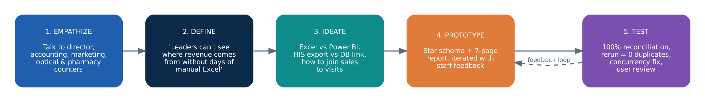
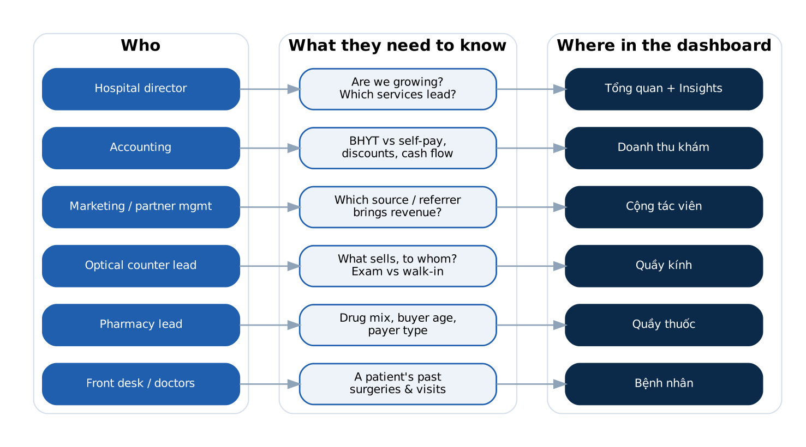
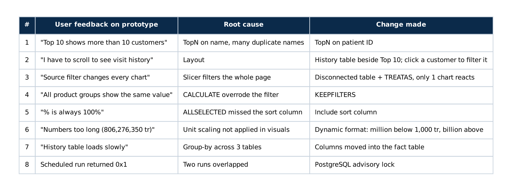

# Design Thinking – Hitech Eye Hospital Analytics

This note explains *why* the solution looks the way it does. It follows the five Design Thinking
stages, and stages 4–5 were repeated several times with hospital staff.

---

## 1. Empathize – who uses the data, and what hurts today

I worked on site at the hospital as the Business Data Analyst for the HIS deployment. The people
who would use the dashboard were the same people already asking for reports.

**Pain points observed:**

| Pain point | Evidence |
|---|---|
| Reports are built by hand | Excel exports copied and pivoted every month; takes days, and the numbers differ between people |
| No view of revenue *sources* | Referral source and referrer are typed into the HIS but never analyzed |
| Sales are disconnected from visits | Optical and pharmacy exports have their own order code, with no patient ID or visit ID |
| Exports are messy | Title rows above the header, a "Total" row, phones losing the leading 0, diagnosis and address in one text field |
| Staff are not technical | The result must open with one link and need no manual refresh |

## 2. Define – the problem statement

> **Hospital leadership needs a trusted, daily-updated view of where revenue comes from**
> (service, referral source, payer, counter) **without anyone rebuilding reports by hand,
> and without changing the HIS.**

Success criteria agreed up front:

1. Numbers reconcile 100% with the HIS export.
2. Fully automatic: new files in → dashboard updated next morning.
3. Re-running never double-counts.
4. Each stakeholder finds their answer in at most 2 clicks.
5. No patient data leaves the hospital.

## 3. Ideate – options considered

| Decision | Options | Chosen | Why |
|---|---|---|---|
| Data source | Direct link to the HIS database / HIS Excel exports | **Excel exports** | No vendor access to the HIS database; exports already exist daily |
| Storage | Power Query only / PostgreSQL warehouse | **PostgreSQL, 3 layers** | Keeps history, makes cleaning repeatable in SQL, reruns are safe |
| Model | One flat table / star schema | **Star schema, 2 facts + 8 dims** | Fast slicing; one calendar shared by exam and sales |
| Loading facts | Append / truncate-reload / delete-and-reload by business key | **Delete + reload by Mã KCB / order ID** | Corrected visits overwrite old rows; no duplicates |
| Joining sales to visits | Customer code / name only / name + same date | **Name + same date** | Customer code turned out to be a per-order code; name alone matches the wrong person |
| Scheduling | Manual button / Task Scheduler + gateway | **Task Scheduler 05:30 + Service refresh 06:00** | Zero clicks; data is ready before staff arrive |
| Sharing | Publish to web / Share or App inside the organization | **Share or App inside the organization** | Report contains patient names and phones |

## 4. Prototype

1. **Data layer first:** raw → staging → dwh SQL scripts, run by hand on real exports.
2. **Dashboard v1:** 6 pages mapped to the stakeholder questions above.
3. **Pipeline v1:** `run_pipeline.py` + `.bat` + Task Scheduler.
4. **Additions after review:**
   - An Insights page of 12 DAX text cards, for readers who will not explore charts.
   - Drill-through from the Top 10 customers to their surgery history.

## 5. Test – feedback loop

Every prototype was reviewed with the users, and each comment became a concrete change:

**Technical tests on real data:**

| Test | Result |
|---|---|
| Source Excel vs. dwh (rows, net revenue) | 16,985 rows · 27.9 bn VND · **100% match** |
| Run the pipeline twice on the same files | **0 duplicates** |
| Two runs started together | Second run skips safely (advisory lock) |
| Export with 4 title rows + "Total" row | Header auto-detected, total row dropped |

## What I would do next

- Ask the HIS vendor to add **patient ID to optical and pharmacy exports**. Only ~62% of pharmacy
  orders can be matched to a visit today.
- Add a data-quality page that shows the last load time, row counts and unmatched sales.
- Move from file exports to a read-only database replica when the vendor allows it.
