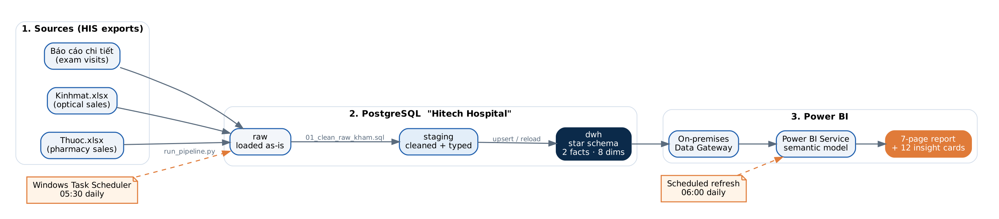
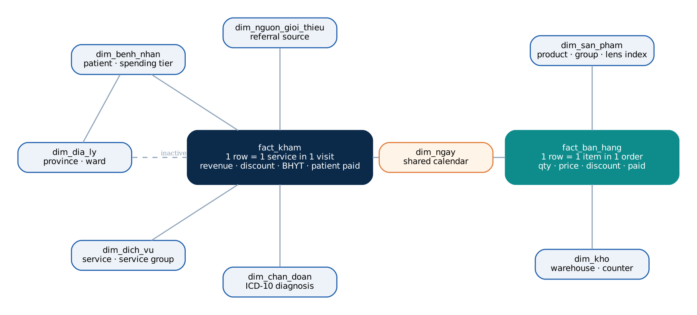
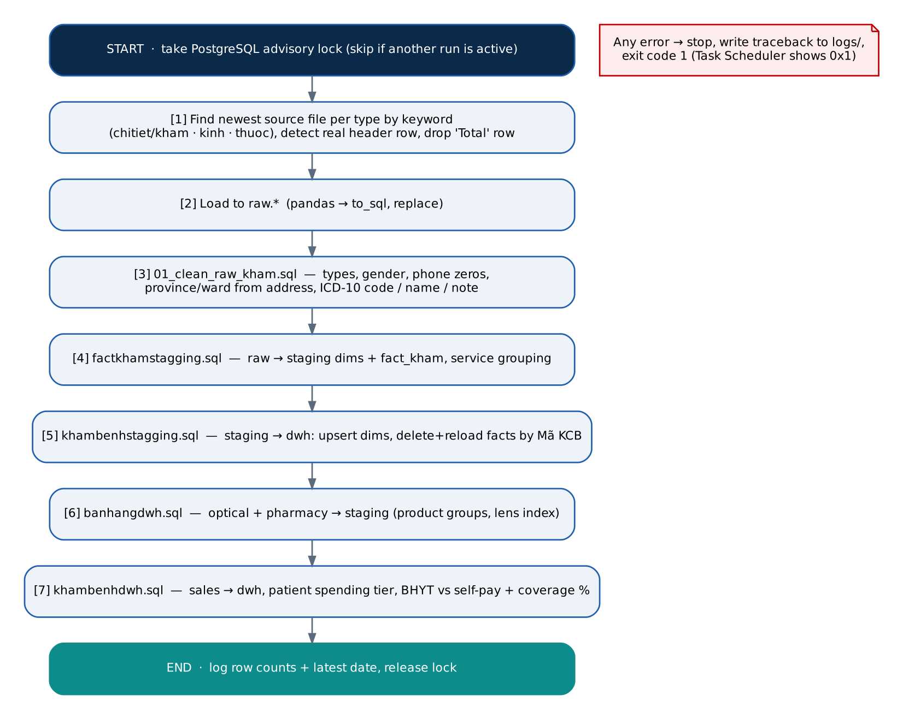
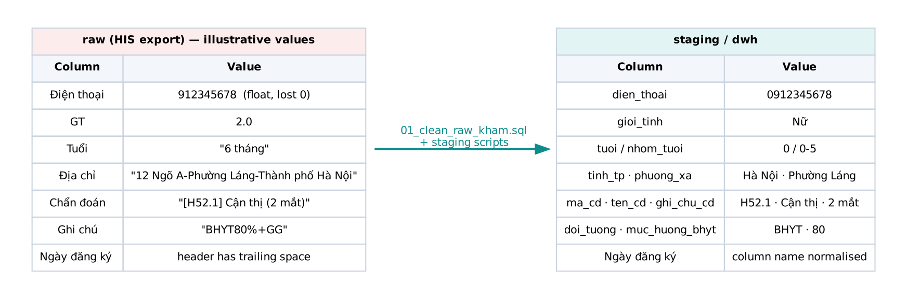
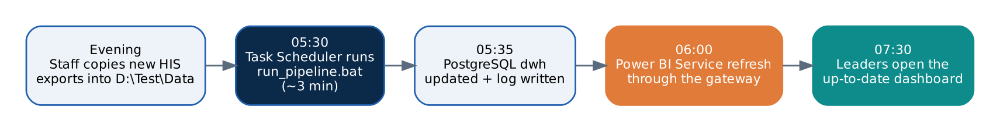

# Hitech Eye Hospital – Revenue & Patient Analytics

> **Real client project.** Built for a 3-location eye hospital in Hanoi and running in production.

Every morning, raw Excel exports from the hospital information system (HIS) are loaded into a PostgreSQL
data warehouse. A 7-page Power BI dashboard then refreshes on Power BI Service, so leadership sees
yesterday's revenue, patients and sales by 7:30 with no manual work.

**Stack:** Python (pandas, SQLAlchemy) · PostgreSQL · SQL · Power BI (DAX, PBIP/TMDL) ·
Power BI Service + On-premises Data Gateway · Windows Task Scheduler

📐 How the project was shaped, from user needs to tested solution: **[DESIGN_THINKING.md](DESIGN_THINKING.md)**

---

## Contents
1. [Business problem](#1-business-problem)
2. [Architecture](#2-architecture)
3. [Data model](#3-data-model)
4. [ETL pipeline step by step](#4-etl-pipeline-step-by-step)
5. [Data cleaning](#5-data-cleaning)
6. [Automation](#6-automation)
7. [Dashboard](#7-dashboard)
8. [Key insights](#8-key-insights)
9. [Quality checks](#9-quality-checks)
10. [Repository structure & how to run](#10-repository-structure--how-to-run)

---

## 1. Business problem

The hospital's HIS only exports flat Excel reports: exam visits, optical counter sales and pharmacy
sales. Each comes as a separate file in a different layout. Before this project:

- Monthly revenue reports were built by hand in Excel and took days.
- Nobody could answer *where revenue comes from*: which referral source, which service, which payer
  (Health Insurance / BHYT vs. self-pay).
- Optical and pharmacy sales could not be linked to exam visits, because the systems share no key.

**Goal:** one trusted, automatically refreshed source of truth for leadership, without changing the HIS.

## 2. Architecture



| Layer | What happens | Why |
|---|---|---|
| **raw** | Excel loaded as-is (`pandas.to_sql`) | Keeps an untouched copy, so cleaning can always be re-run |
| **staging** | Types fixed, text cleaned, codes parsed, surrogate keys built | Isolates cleaning logic from history |
| **dwh** | Star schema with stable keys, upserts and history kept | What Power BI reads; reruns never duplicate data |
| **Power BI** | Semantic model + 7-page report on Power BI Service | Leadership opens one link |

## 3. Data model



- **`fact_kham`**: 1 row = 1 service in 1 visit (Mã KCB). Holds revenue, discount, net revenue,
  insurance amount and patient-paid amount.
- **`fact_ban_hang`**: 1 row = 1 item in 1 optical or pharmacy order.
- **8 dimensions:**
  - patient, geography, service, ICD-10 diagnosis, referral source;
  - product, warehouse;
  - a calendar shared by both facts, so exam revenue and sales can be compared on the same dates.
- `fact_kham → dim_dia_ly` is kept **inactive**. Geography is reached through the patient, which avoids
  an ambiguous filter path.

## 4. ETL pipeline step by step



| Step | File | Details |
|---|---|---|
| 0 | `run_pipeline.py` | Takes a PostgreSQL **advisory lock**. A second run started by mistake exits instead of colliding with the first. |
| 1 | `run_pipeline.py` | Finds the newest file of each type by keyword. Detects the real header row (HIS exports have 4 title rows) and drops the "Total" row. |
| 2 | `run_pipeline.py` | Loads into `raw.*`. |
| 3 | `sql_pipeline/01_clean_raw_kham.sql` | Cleans the exam data (see §5). |
| 4 | `SQL_Anayst/factkhamstagging.sql` | raw → staging: dimensions with `DENSE_RANK` keys, `fact_kham`, rule-based service groups. |
| 5 | `SQL_Anayst/khambenhstagging.sql` | staging → dwh: **upsert** dimensions (SCD1), **delete + reload** facts by Mã KCB, all in one transaction. |
| 6 | `SQL_Anayst/banhangdwh.sql` | Optical + pharmacy → staging: product groups, lens refractive index. |
| 7 | `SQL_Anayst/khambenhdwh.sql` | Sales → dwh. Patient spending tier. BHYT vs. self-pay per visit, with coverage 80/95/100%. |

Each run writes a log file (`logs/pipeline_YYYYMMDD_HHMMSS.log`, last 30 kept). On error, the
pipeline stops and records the traceback. The failing step never leaves half-written data in dwh.

## 5. Data cleaning


*Illustrative values, not real patients.*

- **Phone numbers:** Excel stores them as numbers, so the leading 0 is lost. 9-digit mobiles and
  10-digit landlines starting with 2 get the 0 back.
- **Address:** `…-Phường X-Thành phố Y` is split into ward / province, and "Tỉnh" / "Thành phố"
  prefixes are removed.
- **Diagnosis:** `[ICD] name (note)` is split into 3 columns.
- **Types:** auto-detected per column (integer / decimal / dd/mm/yyyy date). Column names are trimmed.
- **Insurance:** a visit counts as BHYT if any service has an insurance amount or the note mentions
  BHYT. The coverage % is parsed from the note.

## 6. Automation



- `setup_task.bat` creates the 05:30 Windows Task Scheduler job. It also stores the DB password in an
  environment variable instead of the code.
- Power BI Service refreshes at 06:00 through an **On-premises Data Gateway** installed on the
  PostgreSQL machine.
- Step-by-step setup (Vietnamese): [docs/HUONG_DAN_TU_DONG.md](docs/HUONG_DAN_TU_DONG.md)

## 7. Dashboard

Open `powerbi/Hospital.pbip` in Power BI Desktop. Data is not included; point it at your own
PostgreSQL to load.

| Page | Main questions answered |
|---|---|
| Tổng quan · Overview | How are revenue, patients and visits trending? Which services and products lead? |
| Doanh thu khám · Exam revenue | Which service groups drive revenue? Inpatient vs. outpatient? BHYT vs. self-pay? Which promotions? |
| Bệnh nhân · Patients | Who are the top 10 customers? Click one to see their surgery / procedure history. Age, province, returning rate. |
| Cộng tác viên · Referral partners | What share of exam revenue does each source bring? Which referrers bring the most patients? |
| Quầy kính · Optical | Product groups, lens index, buyer age, exam patients vs. walk-in buyers |
| Quầy thuốc · Pharmacy | Drug groups, buyer age, BHYT / self-pay / walk-in split |
| Insights | 12 text cards written by DAX that update with the filters |

**DAX techniques used:**
- Dynamic format strings (values auto-switch between *million* and *billion* VND).
- A disconnected slicer + `TREATAS`, so the source filter affects one chart only.
- `KEEPFILTERS`, and `ALLSELECTED` (including the sort column) for % of total.
- TopN on patient ID.
- Calculated columns that match pharmacy orders to exam visits by name + date.

<!-- Add screenshots (blur patient names / phones first) and uncomment:


-->

## 8. Key insights

| # | Finding | So what |
|---|---|---|
| 1 | **Referral partners bring 29.4%** of exam revenue; **Marketing only 8.7%** | Partner programs pay off more than ads. Review the marketing budget. |
| 2 | Staff relatives bring 19.6%, walk-ins 23.9%, patient word-of-mouth 14.1% | Over half of revenue is relationship-driven. A patient referral scheme is worth testing. |
| 3 | **29.3% of pharmacy revenue** is walk-in buyers who did not have an exam | The pharmacy is a standalone business line, not only an add-on to visits. |
| 4 | Pharmacy revenue: self-pay exam patients 56.9%, BHYT patients 13.8% | Stock planning should follow self-pay demand. |
| 5 | Only ~62% of pharmacy orders can be linked to a visit (name + date) | Ask the HIS vendor to add the patient ID to sales exports. |

## 9. Quality checks

| Check | Result |
|---|---|
| Rows and net revenue: source Excel vs. dwh | **100% match** (16,985 exam service lines) |
| Run the pipeline twice on the same files | **0 duplicate rows** |
| Two runs started at the same time | Second run skips (advisory lock), no failure |
| Patient data in this repo | None. Excel files, Power BI cache (`.pbi/`) and credentials are git-ignored. |

## 10. Repository structure & how to run

```
├── etl/
│   ├── run_pipeline.py          # orchestrator: extract → raw → SQL steps, logging, lock
│   ├── run_pipeline.bat         # entry point for Task Scheduler (uses venv if present)
│   ├── setup_task.bat           # one-time: store DB password + create 05:30 job
│   ├── config.example.py        # copy to config.py
│   ├── sql_pipeline/            # 01_clean_raw_kham.sql
│   └── SQL_Anayst/              # staging / dwh SQL steps
├── powerbi/                     # Hospital.pbip (report + semantic model as code)
├── docs/
│   ├── images/                  # diagrams used in this README
│   ├── diagrams-src/            # Graphviz sources of the diagrams
│   └── HUONG_DAN_TU_DONG.md     # automation & Power BI Service setup guide
├── DESIGN_THINKING.md
└── requirements.txt
```

```bash
pip install -r requirements.txt
cp etl/config.example.py etl/config.py        # set DB URL + data folder
setx HITECH_DB_PASSWORD "<password>"          # Windows
python etl/run_pipeline.py
```

---

**Author:** Trần Quốc Hưng, Data Analyst / Business Analyst ·
[GitHub](https://github.com/tranquochung09062001-dev)
